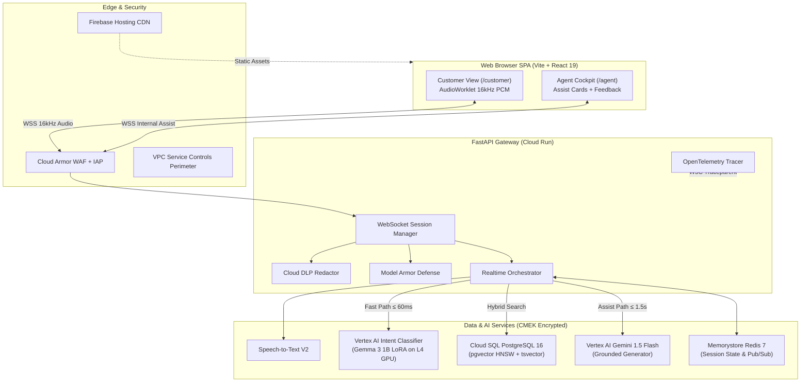

# Contact Center Agent Helper Platform

Enterprise Contact Center Agent Assist platform supporting real-time audio transcription, classifier-based intent detection, and grounded next-best action guidance using hybrid policy RAG.

[](https://www.python.org/downloads/release/python-3140/)
[](https://github.com/astral-sh/uv)
[](https://fastapi.tiangolo.com)
[](https://react.dev)
[](https://github.com/pgvector/pgvector)
[](https://www.w3.org/WAI/WCAG21/quickref/)

---

## 1. System Architecture



---

## 2. Core Technology Stack & Standards

| Layer | Technology | Details |
|---|---|---|
| **Python Runtime** | **Python 3.14.8** | Pinned via `.python-version` and `pyproject.toml`. |
| **Package Manager** | **uv** | Fast, deterministic packaging (`uv venv`, `uv pip`, `uv run`). |
| **Backend API** | **FastAPI + Uvicorn** | Async-first architecture with strict Pydantic v2 event contracts. |
| **Frontend Framework** | **Vite 6 + React 19 + TypeScript** | Pure SPA architecture deployed to Firebase Hosting CDN. |
| **Styling & UI** | **Tailwind CSS v4 + shadcn/ui** | Accessible components complying with WCAG 2.1 AA standards. |
| **Audio Capture** | **Web Audio API + AudioWorklet** | `pcm-recorder-worklet.js` downsampling to 16kHz mono linear PCM. |
| **Vector Store** | **PostgreSQL 16 (pgvector)** | HNSW vector index + `tsvector` hybrid search with Reciprocal Rank Fusion. |
| **Intent Classifier** | **Fine-Tuned Gemma 3 1B LoRA** | Single-pass linear classifier head (p95 latency < 60ms). |
| **Observability** | **OpenTelemetry + Prometheus** | W3C distributed trace propagation (`traceparent`), Cloud Trace, Grafana. |
| **Security & Privacy** | **VPC-SC + Cloud KMS (CMEK)** | Cloud DLP PII redaction and Model Armor prompt defense. |

---

## 3. Local Development Quickstart

### Prerequisites
* macOS / Linux with [uv](https://github.com/astral-sh/uv) installed.
* Docker Desktop or Podman for local PostgreSQL (pgvector) and Redis.

### 1. Backend Setup & Virtual Environment
```bash
# Pin and create environment
uv venv --python 3.14.8 .venv
source .venv/bin/activate

# Install dependencies
uv pip install -r backend/requirements.txt
uv pip install -e ./backend

# Run linting and formatting
uv run ruff check .
uv run ruff format .

# Run offline unit and integration test suite
uv run pytest backend/tests/ -v
```

### 2. Frontend Development Server
```bash
cd apps/web
npm install
npm run dev
# Open http://localhost:3000
```

### 3. Local Docker Compose Stack
```bash
# Launch core stack (PostgreSQL pgvector, Redis, API, Web)
docker compose -f infra/compose/docker-compose.yml up -d

# Launch local observability profile (OTel Collector, Jaeger, Prometheus, Grafana, Loki)
docker compose -f infra/compose/docker-compose.obs.yml up -d
# Access Grafana dashboards at http://localhost:3001 (admin/admin)
# Access Jaeger Tracing at http://localhost:16686
```

---

## 4. Strict Architectural Invariants

1. **Human-in-the-Loop (R14)**:
   * The platform strictly provides *assistive guidance*.
   * It **never** auto-speaks, auto-sends messages to customers, or auto-executes financial banking actions (e.g., fee waivers, card unlocks). All guidance is presented as editable suggestions.
2. **Customer Isolation (R9)**:
   * Customer WebSocket connections are cryptographically restricted to public dialogue events (`session.ready`, `transcript.final`, `transcript.partial`, `session.end`).
   * Internal assist events (`issue.update`, `assist.recommendation`, `guardrail.warning`) are filtered out at the transport layer.
3. **Grounding Safety (R10, R13)**:
   * No recommendation may be presented as `GROUNDED` without supporting evidence from the policy store.
   * If evidence is missing or similarity score is below threshold, output is marked `POLICY_REVIEW_NEEDED` with `MISSING_EVIDENCE`.
4. **Offline Test Isolation**:
   * Unit tests run completely offline without relying on external cloud APIs or live vector databases (`pytest-socket` enforced).

---

## 5. Testing & Verification Suites

| Test Suite | Purpose | Execution Command |
|---|---|---|
| **Unit & Contract Tests** | Pydantic event contracts, domain ports, and DI containers | `uv run pytest backend/tests/ports/ backend/tests/contracts/` |
| **Offline RAG & Invariant Tests** | Grounding verification, policy chunking, and taxonomy rules | `uv run pytest backend/tests/invariants/ backend/tests/pipeline/` |
| **GenAI Quality Evaluation** | Vertex GenAI evaluation and nightly golden scenario replays | `uv run python -m eval.jobs.nightly` |
| **Prompt Injection Red-Team** | Model Armor defense against adversarial injection vectors | `uv run pytest backend/tests/security/injection/` |
| **Chaos Resilience Drills** | Service outage and fallback state machine drills | `uv run pytest backend/tests/chaos/` |
| **High-Concurrency Load Test** | k6 WebSocket test simulating 500 concurrent live sessions | `k6 run tests/load/k6_websocket_call.js` |

---

## 6. Architecture Decision Records (ADRs)

Key architectural decisions are documented in [`docs/adr/`](./docs/adr/):
* [**ADR-001**](./docs/adr/ADR-001-intent-classifier-vs-pure-rag.md): Classifier-Based Intent Detection vs. Pure RAG
* [**ADR-002**](./docs/adr/ADR-002-audioworklet-pcm-streaming.md): Realtime Streaming Audio over AudioWorklet 16kHz PCM
* [**ADR-003**](./docs/adr/ADR-003-hybrid-retrieval-pgvector.md): Hybrid Vector Search using PostgreSQL 16 pgvector
* [**ADR-004**](./docs/adr/ADR-004-spa-firebase-cloudrun-architecture.md): Pure SPA Architecture on Firebase Hosting with Cloud Run Gateway
* [**ADR-005**](./docs/adr/ADR-005-opentelemetry-w3c-tracing.md): End-to-End W3C Distributed Tracing via OpenTelemetry
* [**ADR-006**](./docs/adr/ADR-006-human-in-the-loop-invariant.md): Human-in-the-Loop Assist Invariant (Strict Rule R14)
* [**ADR-007**](./docs/adr/ADR-007-customer-isolation-filter.md): Outbound Event Customer Isolation Filter (Strict Rule R9)
* [**ADR-008**](./docs/adr/ADR-008-vpc-sc-and-cmek-security.md): VPC Service Controls & Customer-Managed Encryption Keys (CMEK)

---

## 7. Production Operations & Runbooks

Operational procedures are documented in [`docs/runbooks/`](./docs/runbooks/):
* [**Incident Response Protocol**](./docs/runbooks/incident_response.md): Severity levels, paging, and triage checklists.
* [**High-Latency Troubleshooting**](./docs/runbooks/high_latency_troubleshooting.md): Diagnosing p95 latency spikes (> 2.5s) via Cloud Trace.
* [**Database Failover & Recovery**](./docs/runbooks/database_failover.md): Cloud SQL multi-zone failover and read replica promotion.
* [**Model Rollback Playbook**](./docs/runbooks/model_rollback.md): Vertex AI intent model traffic splitting and instant canary rollback.
* [**Disaster Recovery Plan**](./docs/runbooks/disaster_recovery.md): Cross-region recovery procedures achieving RPO < 15 min and RTO < 60 min.
* [**Capacity & Scaling Analysis**](./docs/capacity.md): Hardware, network, and memory sizing for 500 to 2,000 concurrent sessions.
