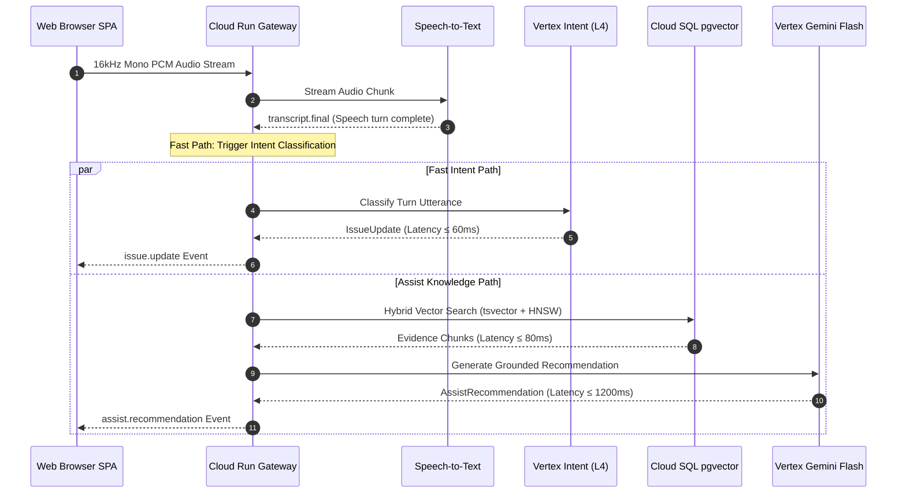

# Contact Center Agent Helper Platform — Capacity & Scaling Analysis

This document provides capacity models, hardware sizing calculations, network bandwidth requirements, and resource limits for running the platform under 500 to 2,000 concurrent active voice/assist sessions.

---

## 1. Traffic Profile & Sizing Assumptions

| Metric | Target (Nominal) | Peak (4x Spike) | Notes |
|---|---|---|---|
| **Concurrent Active Calls** | **500 sessions** | **2,000 sessions** | Active calls with bidirectional WebSockets |
| **Average Call Duration** | 4.5 minutes (270s) | 6.0 minutes (360s) | Based on banking contact center metrics |
| **Audio Format** | 16kHz mono linear PCM (16-bit) | 16kHz mono linear PCM | 256 kbps uncompressed stream per voice channel |
| **Turns per Call** | 10 to 14 turns | 18 to 22 turns | Alternating customer speech and agent responses |
| **Intent Inferences / Sec** | 35 req/s | 140 req/s | 1 intent classification per customer speech turn |
| **Policy Retrievals / Sec**| 35 req/s | 140 req/s | Hybrid dense + sparse search over 14k policy chunks |
| **LLM Recommendations / Sec**| 25 req/s | 100 req/s | Assist triggered for actionable intents |

---

## 2. Component Sizing & Resource Allocation

### A. Cloud Run WebSocket Gateway (`api`)
* **Session Persistence**: Cloud Run Session Affinity enabled (`sessionAffinity: true`) with 3,600s WebSocket connection timeout.
* **Concurrency per Container**: 80 concurrent WebSocket connections.
* **Instance Sizing**: 2 vCPU, 4 GiB Memory per container instance.
* **Instance Capacity**:
  * 500 sessions: $\lceil 500 / 80 \rceil = 7$ instances minimum (provision 10 instances for $N+2$ redundancy).
  * 2,000 sessions: $\lceil 2000 / 80 \rceil = 25$ instances (autoscaling `max_instances = 50`).
* **Memory Headroom**: Each WebSocket connection holds ~12 MB in buffered audio rings, state objects, and TCP windows. 80 connections = ~960 MB, well within 4 GiB container limit.

### B. Network Bandwidth & Ingress
* **Per Session Ingress**: 16,000 samples/sec $\times$ 2 bytes = 32 KB/sec = 256 kbps.
* **500 Concurrent Sessions**: $500 \times 256\text{ kbps} = 128\text{ Mbps}$ (16 MB/sec ingress).
* **2,000 Concurrent Sessions**: $2,000 \times 256\text{ kbps} = 512\text{ Mbps}$ (64 MB/sec ingress).
* Direct VPC Egress / Serverless VPC Access connector configured with `max_throughput = 1000 Mbps` to handle peak egress to Cloud SQL and Memorystore.

### C. Cloud SQL PostgreSQL 16 (pgvector)
* **Instance Sizing**: `db-custom-8-32768` (8 vCPU, 32 GiB RAM, SSD storage).
* **Vector Index**: HNSW index over 768-dimensional embeddings (`vector_cosine_ops`, `m = 16`, `ef_construction = 64`).
* **Connection Pooling**: PgBouncer sidecar configured with `max_client_conn = 2000`, `default_pool_size = 80`.
* **Shared Buffers & Work Mem**: `shared_buffers = 8GB`, `effective_cache_size = 24GB` ensures all 14k HNSW vector index nodes remain hot in memory (index footprint ~85 MB).

### D. Memorystore Redis 7
* **Memory Sizing**: 8 GiB Standard Tier (High Availability with multi-zone automatic failover).
* **Throughput**: ~120,000 operations/sec.
* **Usage**:
  * Session State Store: TTL = 7,200s (150 KB per session context $\times$ 2,000 sessions = 300 MB).
  * Single-Use `jti` JWT join tokens: TTL = 300s (< 10 MB).
  * Pub/Sub cross-instance broadcast: ~2.5 MB/sec at 500 sessions.

### E. Vertex AI Intent Endpoint (Gemma 3 1B LoRA)
* **Accelerator**: NVIDIA L4 GPU (24 GiB VRAM), ONNX Runtime int8 serving.
* **Throughput per L4**: ~35 inferences/sec at p95 latency = 45ms.
* **Autoscaling Configuration**:
  * 500 sessions: 2 $\times$ L4 GPU nodes (70 inferences/sec capacity).
  * 2,000 sessions: 5 $\times$ L4 GPU nodes (175 inferences/sec capacity).
  * Scaled down automatically during off-peak hours (`min_replica_count = 1`).

---

## 3. Golden Signal Latency Budgets & SLO Targets

| Pipeline Step | Target Latency (p50) | Target Latency (p95) | SLO Threshold |
|---|---|---|---|
| **Audio Transcription Turn Finalization** | 250ms | 450ms | < 800ms |
| **Intent Classification (Fast Path)** | 35ms | 58ms | < 250ms |
| **Hybrid Knowledge Retrieval (pgvector)** | 42ms | 78ms | < 200ms |
| **LLM Grounded Recommendation Generation**| 950ms | 1,450ms | < 2,500ms |
| **Total End-to-End Assist Latency** | **1,250ms** | **1,950ms** | **< 2,500ms** |
