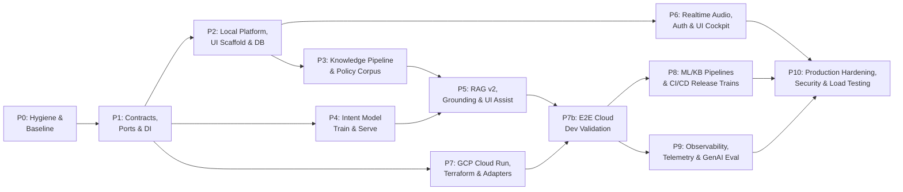

# CC Agent Assist Platform — Phased Implementation Plan

| Field | Value |
|---|---|
| Source spec | [technical_specification.md](./technical_specification.md) (referenced below as **Spec §x**) |
| Supersedes | The build order in [tasks.md](./tasks.md) for the rebuild. |
| Tech Stack Standard | **Vite + React (SPA)** · **Firebase Hosting** · **Tailwind CSS + shadcn/ui** · **Zustand + TanStack Query** · **Web Audio API (AudioWorklet)** · **FastAPI (Python 3.14.8 / uv)** · **PostgreSQL 16 pgvector (Local & Cloud SQL)** |
| Planning assumption | 2–3 engineers across 3 parallel tracks (App, ML, Platform) |
| Status | Final v2.0 (incorporating UI & Full Tech Stack) |

---

## 1. Production Technology Stack & Tooling Architecture

This system is built from the ground up with production quality, zero legacy technical debt, and strict separation between the browser runtime, real-time gateway, ML serving, and data pipelines.

```
┌────────────────────────────────────────────────────────────────────────────────────────┐
│                                   BROWSER CLIENTS                                      │
│  Vite 6 + React 19 + TypeScript (Strict) · Tailwind CSS v4 + shadcn/ui (Radix UI)      │
│  Hosting: Firebase Hosting (Edge CDN for static SPA dist)                              │
│  State: Zustand v5 (Realtime/WS) + TanStack Query v5 (Server Cache)                    │
│  Audio: Web Audio API + AudioWorklet (16kHz mono linear PCM 16-bit signed)             │
└───────────────────────────────────────────┬────────────────────────────────────────────┘
                                            │ Single WebSocket (JSON Envelope + PCM chunks)
                                            ▼
┌────────────────────────────────────────────────────────────────────────────────────────┐
│                              SESSION GATEWAY & REALTIME API                            │
│  FastAPI (Python 3.14.8 / uv) · Uvicorn (ASGI) · Pydantic v2 (Strict Schema Validation)   │
│  Cloud Run (Session Affinity, 3600s WebSocket timeout, min instances ≥ 1)              │
│  Redis 7 (redis-py async): Session State, Inflight Task Locks, Pub/Sub Broadcast       │
│  PostgreSQL 16 (SQLAlchemy 2.0 async + asyncpg + Alembic): Sessions, Transcripts, Audit │
└─────────────┬─────────────────────────────┬────────────────────────────┬───────────────┘
              │                             │                            │
              ▼                             ▼                            ▼
┌──────────────────────────┐  ┌───────────────────────────┐  ┌───────────────────────────┐
│     INTENT SERVICE       │  │        RAG SERVICE        │  │       SPEECH-TO-TEXT      │
│ Local: ONNX Runtime int8 │  │ PostgreSQL 16 pgvector    │  │ Local: Faster-Whisper     │
│ GCP: Vertex AI Endpoint  │  │ (Local Docker / Cloud SQL)│  │ (VAD streaming)           │
│ Base: Gemma 3 1B LoRA    │  │ Rerank: BGE-Reranker-v2-m3│  │ GCP: Cloud Speech-to-Text │
│ Head: Linear Classifier  │  │ Gen: Ollama / Gemini Flash│  │ V2 Streaming (Chirp)      │
└──────────────────────────┘  └───────────────────────────┘  └───────────────────────────┘
```

### 1.1 Detailed Technology Stack Matrix

| Layer | Component | Local Profile (`APP_PROFILE=local`) | GCP Production Profile (`APP_PROFILE=gcp`) |
|---|---|---|---|
| **Frontend Framework** | Client App | **Vite 6 + React 19** (TypeScript 5.x, Pure SPA) | **Firebase Hosting** (Edge CDN for static SPA bundle, direct WSS to Cloud Run) |
| **UI Components & Styling**| Design System | **Tailwind CSS v4** + **shadcn/ui** (Radix UI primitives) | Same |
| **Icons & Typography** | Visual Assets | **Lucide React** + Inter font (`@fontsource/inter`) | Same |
| **Client State Management**| Transient / Realtime | **Zustand v5** (WebSocket, audio buffers, live transcripts) | Same |
| **Server Data Cache** | Async Fetch / Mutation | **TanStack Query v5** (Session join info, CRM, summaries) | Same |
| **Audio Capture** | Browser Microphone | **Web Audio API + AudioWorklet** (`pcm-recorder-worklet.js`) | Same (16kHz 16-bit signed PCM chunks over WS) |
| **Backend Framework** | API Gateway | **FastAPI** (Python 3.14.8, managed with `uv`) | FastAPI on **Cloud Run** (Session affinity, 3600s timeout) |
| **Serialization** | Event Contracts | **Pydantic v2** (`pydantic.BaseModel` with strict typing) | Same |
| **State & Cache Store** | Session & Fan-out | **Redis 7** (Docker container, standalone) | **Memorystore for Redis** (Standard HA, TLS enabled) |
| **Relational Database** | Durable Persistence | **PostgreSQL 16** (Docker container, Alembic) | **Cloud SQL for PostgreSQL 16** (Private IP, IAM Auth) |
| **Object Store** | File / Artifact Store | **fake-gcs-server** (GCS JSON API emulator via `gcsfs`) | **Google Cloud Storage (GCS)** (Versioned, CMEK) |
| **Vector Database** | Semantic Search | **PostgreSQL 16 pgvector** (`pgvector/pgvector:pg16`, HNSW + RRF) | **Cloud SQL for PostgreSQL 16 pgvector** (HNSW + `tsvector` hybrid RRF) |
| **Intent Classifier** | Fast Intent Path | `apps/intent-svc` (ONNX Runtime int8 CPU, <100ms) | **Vertex AI Endpoint** (Gemma 3 1B LoRA on L4 GPU, <60ms) |
| **Text Embeddings** | Vector Embeddings | `sentence-transformers` (`EmbeddingGemma`, 768d) | **Vertex AI Embeddings** (`gemini-embedding-001`, 768d) |
| **Reranker** | Cross-Encoder | `bge-reranker-v2-m3` (local container) | **Vertex AI Ranking API** |
| **LLM Generation** | Structured Synthesis | **Ollama** (`gemma3:4b` or `12b`, JSON mode) | **Vertex AI Gemini 1.5/2.0 Flash** (`response_schema`) |
| **Speech-to-Text** | Audio Transcription | **Faster-Whisper** (streaming VAD) or Text Mock | **Google Cloud Speech-to-Text V2** (Streaming Chirp) |
| **PII & Data Guard** | Sanitization | **Microsoft Presidio** (Local spaCy pipeline) | **Cloud Sensitive Data Protection (DLP)** |
| **Observability** | Telemetry & Logs | **OTel Collector** → Jaeger + Prometheus + Grafana | **Cloud Trace** + **Cloud Monitoring** + **Cloud Logging** |
| **Ingress & Security** | Reverse Proxy / Auth | Local Vite Dev Proxy / Nginx | **Cloud Armor** + **Identity-Aware Proxy (IAP)** |

---

## 2. Frontend Architecture & User Interface Design

The frontend is a single responsive Single Page Application (SPA) built with Vite, React, and TypeScript. It hosts two dedicated route workspaces:
- `/customer` — **Customer Voice/Chat Widget**
- `/agent` — **3-Column Agent Cockpit**

### 2.1 Customer View (`/customer`)
A clean, consumer-grade banking communication widget designed to minimize distraction while capturing pristine microphone audio.

1. **Microphone Permission & Connection Banner**:
   - Explicit browser mic permission prompt with clean recovery instructions if denied.
   - Dynamic connection status badge (`Connected`, `Connecting...`, `Reconnecting...`, `Session Ended`).
2. **Audio Waveform Visualizer**:
   - Real-time animated canvas waveform powered by `AudioContext.createAnalyser()`.
   - Visual pulsation reflecting incoming and outgoing audio levels.
3. **Audio & Chat Controls**:
   - Large, accessible Mic Toggle Button (Mute/Unmute) with keyboard shortcut (`Space` to toggle).
   - Text fallback input field for sending manual chat messages.
4. **Conversation Transcript**:
   - Streamed conversation bubbles showing Customer (right, primary blue) and Agent (left, neutral slate).
   - Zero internal assist outputs, zero guardrail alerts, and zero policy data are sent to or rendered in this view (enforcing R14).

### 2.2 Agent Cockpit (`/agent`)
A high-density 3-column contact center cockpit inspired by Bloomberg Terminal and modern CRM cockpits, engineered for rapid scanning under live call pressure.

```
┌────────────────────────────────────────────────────────────────────────────────────────────────────────┐
│ TOP BAR: Call Duration (04:12) · Session ID · Customer: [Active ●] Agent: [Active ●] · [Mute] [End Call]│
├─────────────────────────┬────────────────────────────────────────┬─────────────────────────────────────┤
│ LEFT: CUSTOMER CONTEXT  │ CENTER: LIVE ROLLING TRANSCRIPT        │ RIGHT: AI ASSIST & GROUNDING        │
│ ─────────────────────── │ ────────────────────────────────────── │ ─────────────────────────────────── │
│ [Profile Card]          │ [Search in transcript...]              │ [INTENT CHIP: card_arrival (94%)]   │
│ Sarah Jenkins (Tier 1)  │                                        │   └─ [Why? View 3 Exemplars]        │
│ Checking: $4,230.12     │ [10:02:14] Agent:                      │                                     │
│ Visa Platinum: **4102   │ Hello! How can I help you today?       │ [GROUNDING BANNER: GROUNDED ●]      │
│ Status: Active          │                                        │                                     │
│                         │ [10:02:18] Customer:                   │ [NEXT-BEST ACTION PLAYBOOK]         │
│ [Recent Activity]       │ My debit card hasn't arrived even      │ 1. [ ] Verify mailing address       │
│ • Travel Notice (Active)│ after waiting for 2 weeks.             │ 2. [ ] Check courier tracking link  │
│ • Overdraft waiver req. │   (partial: "still waiting for it...") │ 3. [ ] Reissue expedited if >10 days│
│                         │                                        │    [Action Type: VERIFY]            │
│ [Scenario Metadata]     │ [10:02:24] Agent:                      │                                     │
│ Card Delivery Delay     │ I can certainly check the delivery     │ [SUGGESTED RESPONSE DRAFT]          │
│ Priority: High          │ status for you right away.             │ "I apologize for the delay. Let me  │
│                         │                                        │  verify your shipping address..."   │
│                         │                                        │  [Copy] [Insert into Editor]        │
│                         │                                        │                                     │
│                         │                                        │ [EVIDENCE DRAWER (Collapsible)]     │
│                         │                                        │ • Policy: pol-card-007 (0.92)       │
│                         │                                        │ • FAQ: faq-1182 (0.87)              │
├─────────────────────────┴────────────────────────────────────────┴─────────────────────────────────────┤
│ BOTTOM: Inline Draft Reply Box · Agent Notes · [Complete Call & Generate Summary Modal]               │
└────────────────────────────────────────────────────────────────────────────────────────────────────────┘
```

#### Detailed Column Breakdown:
1. **Top Header & Call Controls**:
   - Active call timer (MM:SS), session UUID badge, and round-trip ping latency.
   - Dual connection status indicators for both participants.
   - Audio input selector and Mic Mute/Unmute toggle.
   - Prominent "End Call" button that halts audio and triggers summary generation.
2. **Left Column — Customer & Context Panel**:
   - Synthetic CRM Customer Card: name, VIP tier, account numbers (masked), active balances.
   - Active account flags (e.g., "Recent travel notice", "Suspicious charge flagged").
   - Scenario context badge detailing the scripted demo situation.
3. **Center Column — Live Rolling Transcript**:
   - Virtualized auto-scrolling message timeline with smooth pause-on-scroll.
   - Distinct bubble typography distinguishing Customer vs. Agent turns.
   - Visual differentiation between `transcript.partial` (subtle italic text with animated audio dots) and `transcript.final` (crisp text with timestamp).
   - Instant in-transcript text search filter.
4. **Right Column — Real-Time Assist & Grounding Panel**:
   - **Intent Hypothesis Chip**: Displays detected canonical intent + calibrated confidence percentage. Clicking "Why?" opens a drawer showing the 3 nearest training exemplar utterances.
   - **Grounding Safety Banner**: Color-coded status indicator:
     - `GROUNDED` (Emerald green): Full evidence available; all actions safe.
     - `LOW_CONFIDENCE` (Amber): Caution banner advising agent verification.
     - `MISSING_EVIDENCE` (Rose red): Guidance suppressed; fallback to manual lookup.
     - `POLICY_REVIEW_NEEDED` (Purple): Action requires policy verification before proceeding.
   - **Next-Best Action (NBA) Cards**: Interactive step-by-step checklists with action-type pills (`verify`, `inform`, `escalate`).
   - **Suggested Response Cards**: Conversational draft ready for the agent to say aloud, with 1-click "Copy to Clipboard" and "Insert into Editor".
   - **Evidence Drawer**: Collapsible panel displaying the exact retrieved Policy and FAQ markdown snippets, citation IDs, and similarity scores.
5. **Post-Call Summary Modal**:
   - Pops up automatically when the call ends (`summary.ready` event).
   - Displays structured sections: `Call Overview`, `Key Issues Discussed`, `Actions Completed`, `Required Follow-ups`, and a copy-ready `CRM Case Note Draft`.

### 2.3 Audio Capture Pipeline (Web Audio API + AudioWorklet)
The POC's native MediaRecorder is replaced with an enterprise-grade `AudioWorklet`:
1. `navigator.mediaDevices.getUserMedia({ audio: { channelCount: 1, sampleRate: 48000, echoCancellation: true, noiseSuppression: true } })` acquires raw audio.
2. An isolated `pcm-recorder-worklet.js` processor runs on the browser's audio rendering thread (completely immune to UI jank or React re-renders).
3. The worklet performs downsampling from the device rate (44.1kHz or 48kHz) down to **16kHz mono linear 16-bit signed PCM**.
4. Chunks of 100ms (1,600 samples = 3,200 bytes) are transferred via `postMessage` to the main thread.
5. The WebSocket client packages the binary PCM chunk with a sequential header (`seq`, `session_id`, `role`) and streams it to `/ws/session/{session_id}`.

---

## 3. Implementation Phases



### Timeline & Effort Allocation (3 Parallel Tracks)

| Track | Focus | Parallel Workflows |
|---|---|---|
| **App Track** | Frontend (Vite/React/Tailwind), Backend API, WebSocket gateway, UI Cockpit | P0 → P1 → P2 → P3 → P5 → P6 → P10 |
| **ML Track** | Dataset preparation, LoRA fine-tuning, Intent evaluation, Reranker, RAG verifier | P0 → P1 → P4 → P5 (verifier) → P8 → P9 |
| **Platform Track**| Docker Compose, Terraform modules, GCP infrastructure, CI/CD, Observability | P1 → P7 → P7b → P8 → P9 → P10 |

---

### P0 — Hygiene & Baseline
**Goal:** Clean, secure, reproducible starting point; configure security tooling and establish golden baseline.
**Depends on:** —  **Track:** App + ML

| ID | Task | Files |
|---|---|---|
| P0.1 | **Security Tooling Setup:** Configure `gitleaks` secret scanning and `ruff` linter/formatter in pre-commit hooks and CI workflow | `.pre-commit-config.yaml`, `.github/workflows/ci.yml` |
| P0.2 | **Python Runtime Pinning:** Pin **Python 3.14.8** across all configs (`uv.lock`, CI, Dockerfiles, pyproject.toml) | `pyproject.toml`, `.github/workflows/ci.yml`, `README.md`, `.python-version` |
| P0.3 | **Import & Project Root Standardization:** Standardize on `app.*` with `backend/` as root. Configure `backend/pyproject.toml` and merge `tests/` into `backend/tests/` | `backend/pyproject.toml`, `backend/app/**`, `backend/tests/**` |
| P0.4 | **Corpus Paths Configuration:** Add unified `CorpusPaths` configuration object and set `MAX_RECORDS_PER_STORE=0` (unlimited) | `backend/app/pipeline/paths.py`, `backend/app/core/config.py` |
| P0.5 | **Golden Scenario Fixtures (R17):** Card declined, fee dispute, travel notice, lost card, charged twice, plus 2 OOS chit-chat scripts with expected intents | `eval/scenarios/*.json`, `eval/schema.py` |
| P0.6 | **Baseline Measurement:** Benchmark initial intent retrieval and log accuracy/latency report | `eval/reports/baseline.md` |
| P0.7 | **Requirements Alignment:** Formally amend R8/R9 in `docs/requirements.md` to reflect classifier-based intent detection | `docs/requirements.md` |

**Exit Criteria:**
- [x] CI green on Python 3.14.8; `gitleaks` clean across full git history.
- [x] Full normalized corpora indexable without path errors (~13k intent, ~1.7k FAQ).
- [x] Baseline accuracy report committed.

---

### P1 — Contracts, Ports & Dependency Injection
**Goal:** Define stable, bidirectional event contracts, domain entities, and decoupled port interfaces for both frontend and backend.
**Depends on:** P0  **Track:** App

| ID | Task | Files |
|---|---|---|
| P1.1 | **Versioned WebSocket Event Contracts (v1):** Pydantic v2 discriminated union models for all inbound/outbound events. Provenance fields: `model_version`, `taxonomy_version`, `corpus_version`, `prompt_version` | `backend/app/contracts/events_v1.py` |
| P1.2 | **Domain models:** `IntentPrediction`, `EvidenceChunk`, `GroundingDecision`, `NextBestAction`, `SuggestedResponse`, `CallSummary` | `backend/app/domain/*.py` |
| P1.3 | **Backend Ports (Protocols):** `IntentClassifier`, `SpeechToText`, `Embedder`, `VectorIndex`, `DocumentStore`, `Reranker`, `Generator`, `SessionStateStore`, `EventBus`, `BlobStore`, `PIIRedactor` | `backend/app/ports/*.py` |
| P1.4 | **Frontend TypeScript Contracts:** Generate strict TypeScript interfaces from Pydantic schemas for WS events and API payloads | `apps/web/src/types/contracts.ts` |
| P1.5 | **Zustand store interfaces:** Define contract interfaces for `useSessionStore`, `useTranscriptStore`, `useAssistStore`, and `useAudioStore` | `apps/web/src/stores/types.ts` |
| P1.6 | **Test adapters:** In-memory deterministic adapters for all ports | `backend/app/adapters/test/*.py` |
| P1.7 | `Settings` (pydantic-settings) with `APP_PROFILE=local|gcp|test` and dependency injection container | `backend/app/core/config.py`, `backend/app/core/container.py` |
| P1.8 | **Transcript replay runner:** Feeds golden scenario transcripts into the orchestrator without live audio | `backend/app/eval/replay_runner.py` |
| P1.9 | Strict mypy setup on all contracts and ports; `pytest-socket` to prevent accidental network calls in unit tests | `backend/pyproject.toml`, `ci.yml` |

**Exit Criteria:**
- [ ] TypeScript and Python contracts perfectly aligned; serialization tests pass 100%.
- [ ] Backend test suite runs completely offline with `APP_PROFILE=test`.

---

### P2 — Local Platform, Persistence & Frontend Scaffolding
**Goal:** Launch the one-command local stack (Docker Compose) and scaffold the new Vite + React + Tailwind + shadcn/ui application.
**Depends on:** P1  **Track:** App  **Checkpoint:** D4 (pgvector)

| ID | Task | Files |
|---|---|---|
| P2.1 | **Docker Compose `core`:** `web`, `api`, `postgres:16` (`pgvector/pgvector:pg16`), `redis:7`, `fake-gcs-server` with explicit healthchecks and dependency ordering | `infra/compose/docker-compose.yml` |
| P2.2 | **Scaffold Frontend SPA:** Initialize Vite 6 + React 19 + TypeScript in `apps/web/`. Configure Tailwind CSS v4 and `tsconfig.json` paths | `apps/web/package.json`, `apps/web/vite.config.ts`, `apps/web/tailwind.config.ts` |
| P2.3 | **Setup shadcn/ui:** Install Radix UI primitives, Lucide icons, setup `@/components/ui` (`button`, `card`, `dialog`, `badge`, `tabs`, `scroll-area`, `tooltip`, `drawer`, `sheet`) | `apps/web/src/components/ui/**`, `apps/web/components.json` |
| P2.4 | **Client Routing & Layout Shell:** Implement `react-router-dom` routes: `/` (Landing/Join), `/customer` (Customer View), `/agent` (Agent Cockpit) | `apps/web/src/App.tsx`, `apps/web/src/routes/**` |
| P2.5 | **Alembic Database Schema:** Migrations for `sessions`, `participants`, `transcript_segments`, `issue_predictions`, `recommendations`, `recommendation_sources`, `response_suggestions`, `summaries`, `audit_events`, `kb_chunks` (with `vector(768)` & `tsvector`), `feedback_events` | `backend/app/db/models.py`, `backend/migrations/**` |
| P2.6 | **Postgres Repositories:** Async SQLAlchemy repositories replacing in-memory dictionaries | `backend/app/adapters/postgres/*.py` |
| P2.7 | **Redis Session State Store:** Manage active turn windows, inflight asyncio task locks, and published message deduplication hashes | `backend/app/adapters/redis/state_store.py` |
| P2.8 | **Audit Service:** Typed audit logger persisting all R16 audit categories to PostgreSQL | `backend/app/services/audit_service.py` |
| P2.9 | **Production Container & Frontend Builds:** Multi-stage production Dockerfiles: `apps/api/Dockerfile` (uv, Python 3.14.8-slim) and `apps/web/` build setup targeting Firebase Hosting (`firebase.json`) | `apps/api/Dockerfile`, `apps/web/Dockerfile`, `firebase.json` |
| P2.10| **Developer Makefile:** `make up`, `make up-mock`, `make down`, `make seed`, `make test`, `make lint` | `Makefile` |

**Exit Criteria:**
- [ ] `make up-mock` starts all containers healthy; browser opens `http://localhost:3000` showing shadcn/ui interface.
- [ ] Database migrations execute cleanly; sessions, audit logs, and pgvector extension persist across container restarts.

---

### P3 — Knowledge Pipeline & Policy Corpus
**Goal:** Build the governed, versioned knowledge pipeline with an authored **Policy Store** and PostgreSQL pgvector indexing.
**Depends on:** P2  **Track:** App  **Checkpoints:** D3, D7

| ID | Task | Files |
|---|---|---|
| P3.1 | **Taxonomy Registry:** Banking77 + project labels (`travel_notice`, `fee_dispute`, `fraud_report`, `out_of_scope`); alias mappings; `requires_policy` flags; validation CLI | `taxonomy/intents.yaml`, `taxonomy/aliases.yaml`, `pipeline/taxonomy.py` |
| P3.2 | **Policy Authoring Schema & Governance:** Markdown + YAML front matter schema with strict CODEOWNERS compliance review workflow | `corpora/policy/_schema.json`, `.github/CODEOWNERS` |
| P3.3 | **Author POC Policy Corpus:** Synthetic banking policies covering 100% of `requires_policy=true` intents (disputes, travel notices, card blocks, fee waivers) | `corpora/policy/*.md` |
| P3.4 | **Policy Loader & Chunker:** Heading-aware Markdown chunker (300–500 tokens, 15% overlap, preserving numbered procedures) | `pipeline/loaders/policy_loader.py`, `pipeline/normalizers/policy_normalizer.py`, `pipeline/processors/chunking.py` |
| P3.5 | **FAQ Intent Tagging:** Offline semantic linking of FAQ records to taxonomy intent labels with committed review CSV | `pipeline/jobs/tag_faq_intents.py`, `corpora/faq_intent_tags.csv` |
| P3.6 | **Medallion Data Layout:** Raw → Normalized → Chunks → Embeddings with quarantine area for invalid records | `pipeline/paths.py`, `pipeline/jobs/*.py` |
| P3.7 | **Corpus Manifest & Startup Guard:** Emit `manifest.json`; runtime startup check halts if local embedder model does not match index metadata | `pipeline/manifest.py`, `backend/app/core/startup_checks.py` |
| P3.8 | **Local Embedder:** `EmbeddingGemma` via `sentence-transformers` with query/document task-type prefixes | `backend/app/adapters/local/embedder.py` |
| P3.9 | **PostgreSQL pgvector Adapter:** Dense (HNSW cosine) + full-text (`tsvector`) hybrid vector search with Reciprocal Rank Fusion (RRF), payload filtering (`intent_labels`, `status`), and active version routing | `backend/app/adapters/postgres/vector_index.py` |
| P3.10| **Indexing Jobs:** `kb_build` (full index/partition), `kb_promote` (blue/green view/pointer flip), `kb_upsert` / `kb_retire` (incremental updates) | `pipeline/jobs/kb_*.py` |
| P3.11| **Data Quality Assertions:** CI assertions for 100% intent coverage, train/test leakage isolation, and zero PII detection | `pipeline/quality/*.py` |
| P3.12| **Retrieval Evaluation Harness:** Ground-truth qrels mapping golden queries to expected policy/FAQ chunk IDs; measures Recall@k and nDCG@5 | `eval/retrieval/qrels.jsonl`, `eval/retrieval/run.py` |

**Exit Criteria:**
- [ ] `make seed` generates identical corpus hashes; 100% of policy-required intents have active policy chunks.
- [ ] Blue/green active version switch succeeds in PostgreSQL with zero dropped search queries.
- [ ] Retrieval Recall@20 ≥ 0.95 (ensuring sufficient candidates for downstream reranking).

---

### P4 — Intent Model: Training & Serving
**Goal:** Fine-tune Gemma 3 1B LoRA classifier, satisfy all quality gates, and serve via ONNX Runtime int8 container.
**Depends on:** P1, P3.1  **Track:** ML  **Checkpoint:** D1

| ID | Task | Files |
|---|---|---|
| P4.1 | **Dataset Preparation:** Stratified train/val from Banking77 train, Banking77 test held out, CLINC150 out-of-scope utterances, synthetic conversational chit-chat | `ml/intent/data/prepare.py` |
| P4.2 | **Conversational Augmentation:** Offline generation of multi-turn spoken dialogue with realistic ASR disfluencies and missing punctuation | `ml/intent/data/augment.py`, `ml/intent/data/spotcheck.md` |
| P4.3 | **LoRA Training Pipeline:** Hugging Face `AutoModelForSequenceClassification` + PEFT LoRA (r=16, α=32), class weights, label smoothing | `ml/intent/train.py`, `ml/intent/configs/{dev,full}.yaml` |
| P4.4 | **Temperature Calibration & Decision Layer:** Post-training temperature scaling on validation split; out-of-scope threshold `τ_oos`; multi-issue ambiguity rule | `ml/intent/calibrate.py`, `ml/intent/decision.py` |
| P4.5 | **Model Evaluation & Gates:** Compute accuracy, macro-F1, per-class F1, ECE calibration plot, OOS precision/recall curve, latency benchmark | `ml/intent/evaluate.py`, `ml/intent/gates.py` |
| P4.6 | **First Training Run:** Execute baseline run on local GPU or one-off cloud instance; evaluate against Champion criteria; check D1 | `ml/intent/jobs/train_local.sh` |
| P4.7 | **Export & Quantization:** Merge LoRA weights into safetensors (bf16); export to ONNX Runtime int8 for local CPU serving | `ml/intent/export.py` |
| P4.8 | **`intent-svc` Serving Container:** Fast, lightweight FastAPI microservice hosting ONNX Runtime int8 model; Vertex custom container contract compliant | `apps/intent-svc/**` |
| P4.9 | **Backend Client & Fallback:** `HttpIntentClassifier` adapter with automatic fallback to exemplar-kNN (`degraded=true`) if service is unreachable | `backend/app/adapters/intent/*.py` |
| P4.10| **Orchestrator Integration:** Hook classification into customer speech turns with 300ms debounce; publish `issue.update` events | `backend/app/services/realtime_orchestrator.py` |
| P4.11| **Agent UI Intent Chip Component:** Render detected intent badge with confidence percentage and a modal drawer showing the 3 nearest training exemplars | `apps/web/src/components/agent/IntentChip.tsx`, `apps/web/src/components/agent/ExemplarDrawer.tsx` |

**Exit Criteria (Spec §3.2.4 Quality Gate):**
- [ ] Test Accuracy ≥ 0.93, Macro-F1 ≥ 0.92, ECE ≤ 0.05, OOS Recall ≥ 0.85 at in-scope Precision ≥ 0.95.
- [ ] Golden scenario top-1 accuracy = 100%; local CPU int8 latency p95 ≤ 250ms.
- [ ] UI correctly renders intent chip and opens exemplar drawer.

---

### P5 — RAG v2, Grounding State Machine & UI Assist Components
**Goal:** Implement intent-conditioned hybrid retrieval, cross-encoder reranking, structured generation, claim verification, and rich agent assist cards.
**Depends on:** P3, P4  **Track:** App (+ ML for verifier)  **Checkpoint:** D5

| ID | Task | Files |
|---|---|---|
| P5.1 | **Query Builder:** Synthesize search queries from last 3 customer turns + intent label + taxonomy description | `backend/app/services/rag/query_builder.py` |
| P5.2 | **Store Router & Relax Retry:** Parallel dispatch across `policy` and `faq` stores with intent filtering; single filter-relax retry on empty match | `config/retrieval_routes.yaml`, `backend/app/services/rag/router.py` |
| P5.3 | **Local Reranker Adapter:** `bge-reranker-v2-m3` cross-encoder container running in Compose `ml` profile | `backend/app/adapters/local/reranker.py`, `infra/compose/docker-compose.ml.yml` |
| P5.4 | **Threshold Calibration:** Calibrate `τ_evidence` and `τ_policy` from evaluation qrels, writing to configuration | `eval/retrieval/calibrate_thresholds.py`, `config/grounding.yaml` |
| P5.5 | **Structured Generation Schemas:** Pydantic output schemas defining strictly cited `NextBestAction` and `SuggestedResponse` drafts | `backend/app/services/rag/schemas.py`, `prompts/nba_v1.md` |
| P5.6 | **Local Generator Adapter:** Ollama generator (`gemma3`) with JSON-schema constrained decoding, 2s timeout | `backend/app/adapters/local/ollama_generator.py` |
| P5.7 | **Claim & Citation Verifier:** Validate that all cited chunk IDs exist in context; run NLI cross-encoder entailment check; strip uncited claims | `backend/app/services/rag/verifier.py` |
| P5.8 | **Deterministic Grounding State Machine:** Implement Spec §3.3.3 state machine: `GROUNDED`, `LOW_CONFIDENCE`, `MISSING_EVIDENCE`, `POLICY_REVIEW_NEEDED` | `backend/app/services/grounding/state_machine.py` |
| P5.9 | **Playbook Fallback:** Migrate hardcoded rules to YAML playbooks populated strictly with retrieved policy steps if generation fails | `playbooks/*.yaml`, `backend/app/services/rag/fallback.py` |
| P5.10| **Invariant Test Suite:** Assert that `GROUNDED` outputs always have citations, and operational actions always possess policy citations | `backend/tests/invariants/*.py` |
| P5.11| **Summary Service v2:** End-of-call structured summarizer linking transcript segments to completed actions and case notes | `backend/app/services/summary_service.py`, `prompts/summary_v1.md` |
| P5.12| **UI Grounding Banner:** Render alert banner styled per safety state with tooltips detailing missing or conflicting evidence | `apps/web/src/components/agent/GroundingBanner.tsx` |
| P5.13| **UI Next-Best Action Cards:** Checklist cards with step-by-step guidance, action-type badges (`verify`, `inform`, `escalate`), and interactive checkmarks | `apps/web/src/components/agent/NextBestActionCard.tsx` |
| P5.14| **UI Suggested Response Card:** Conversational reply draft with 1-click "Copy to Clipboard", "Insert into Editor", and inline edit mode | `apps/web/src/components/agent/SuggestedResponseCard.tsx` |
| P5.15| **UI Evidence Drawer:** Slide-over sheet showing matched Policy & FAQ cards, verbatim text snippets, citation IDs, and similarity score meters | `apps/web/src/components/agent/EvidenceDrawer.tsx` |
| P5.16| **UI Post-Call Summary Modal:** Dialog showing full call overview, action items, and copyable CRM wrap-up note draft | `apps/web/src/components/agent/SummaryModal.tsx` |

**Exit Criteria:**
- [ ] Invariant tests pass 100%: zero operational actions generated without policy support.
- [ ] Post-rerank Policy Recall@5 ≥ 0.90, nDCG@5 ≥ 0.80.
- [ ] Agent UI renders full assist suite with dynamic grounding states and working evidence drawer.

---

### P6 — Realtime Voice, Security & Cockpit Polish
**Goal:** Production AudioWorklet voice streaming, signed token authentication, multi-instance Redis fan-out, and 3-column cockpit.
**Depends on:** P2  **Track:** App

| ID | Task | Files |
|---|---|---|
| P6.1 | **Signed Join Tokens:** JWT signed tokens bound to `session_id` + `role`, 15-minute TTL, single-use `jti` stored in Redis | `backend/app/core/security.py`, `backend/app/ws/session.py` |
| P6.2 | **Role-Based Outbound Event Filter:** Strict server-side filter preventing internal assist/guardrail events from ever streaming to customer sockets | `backend/app/ws/fanout.py` |
| P6.3 | **Multi-Instance Redis Pub/Sub:** Redis channel per session; allows participants on different FastAPI worker nodes to communicate seamlessly | `backend/app/adapters/redis/event_bus.py` |
| P6.4 | **AudioWorklet Processor:** Implement `pcm-recorder-worklet.js` performing high-quality 16kHz mono linear 16-bit PCM downsampling on audio thread | `apps/web/public/pcm-recorder-worklet.js`, `apps/web/src/audio/useAudioWorklet.ts` |
| P6.5 | **Local Faster-Whisper Adapter:** Streaming STT adapter using Silero VAD to emit `transcript.partial` and `transcript.final` events | `backend/app/adapters/local/whisper_stt.py` |
| P6.6 | **Customer UI View (`/customer`):** Real-time waveform canvas visualizer, mic mute toggle, connection state pill, conversation bubbles | `apps/web/src/routes/CustomerView.tsx`, `apps/web/src/components/customer/WaveformVisualizer.tsx` |
| P6.7 | **Agent UI Cockpit Assembly (`/agent`):** Full 3-column responsive desktop layout integrating Context, Transcript, Assist, and Header | `apps/web/src/routes/AgentCockpit.tsx`, `apps/web/src/components/agent/**` |
| P6.8 | **Transcript Timeline Component:** Virtualized message timeline with partial styling (pulsing indicator) and keyword search highlight | `apps/web/src/components/agent/TranscriptTimeline.tsx` |
| P6.9 | **Customer Context Panel:** Synthetic profile display (VIP tier, masked account numbers, balances, recent activity badges) | `apps/web/src/components/agent/CustomerContextPanel.tsx` |
| P6.10| **Resilience & Reconnect:** Exponential backoff WebSocket reconnection, packet sequence tracking, and missing chunk drop resilience | `apps/web/src/services/websocket.ts`, `backend/app/services/transcription.py` |

**Exit Criteria:**
- [ ] End-to-end voice streaming: browser mic → AudioWorklet → WS → Faster-Whisper → live transcript on UI.
- [ ] Waveform visualizer pulses cleanly with user voice; 3-column Agent Cockpit fully functional.
- [ ] Customer sockets strictly isolated from agent recommendations (asserted via security test).

---

### P7 — GCP Infrastructure, Terraform & Cloud Adapters
**Goal:** Provision production GCP environment with Terraform and implement all GCP-native port adapters.
**Depends on:** P1, P5  **Track:** Platform  **Checkpoints:** D2, D6

| ID | Task | Files |
|---|---|---|
| P7.1 | **Terraform Bootstrap & Core Project:** Enable APIs, configure remote GCS state bucket, provision Artifact Registry, create KMS keys | `infra/terraform/bootstrap/**`, `infra/terraform/modules/{project,registry,storage}` |
| P7.2 | **Workload Identity Federation (WIF):** GitHub Actions IAM integration without long-lived JSON keys | `infra/terraform/modules/iam` |
| P7.3 | **Networking Module:** VPC, Cloud NAT, Serverless VPC Access / Direct VPC Egress for Cloud Run, Private Service Access for Cloud SQL & Memorystore | `infra/terraform/modules/network` |
| P7.4 | **Database & Redis Modules:** Cloud SQL PostgreSQL 16 with `pgvector` extension flag enabled (Private IP, IAM Auth) and Memorystore Redis (Standard HA, TLS) | `infra/terraform/modules/{sql,redis}` |
| P7.5 | **Firebase Hosting Provisioning:** Configure Firebase Hosting project/targets for Vite SPA with edge CDN distribution and TLS | `firebase.json`, `.firebaserc`, `infra/terraform/modules/firebase` |
| P7.6 | **Vertex AI Intent Endpoint:** Provision endpoint shell with L4 GPU autoscaling; deploy P4 intent classifier model | `infra/terraform/modules/vertex_endpoint`, `ml/intent/jobs/deploy_endpoint.sh` |
| P7.7 | **Cloud Run API Gateway:** Deploy `api` (Session affinity, 3600s WebSocket timeout, min instances ≥ 1, direct WSS entrypoint) | `infra/terraform/modules/cloud_run_service` |
| P7.8 | **Cloud Armor & IAP Security:** Global HTTPS Load Balancer with Cloud Armor WAF and Identity-Aware Proxy guarding `/agent` routes | `infra/terraform/modules/lb_armor_iap`, `backend/app/core/iap.py` |
| P7.9 | **GCP Port Adapters:** Vertex Embeddings (`gemini-embedding-001`), Cloud SQL pgvector async adapter, Vertex Ranking API, Gemini Flash (`response_schema`), Google STT V2 streaming | `backend/app/adapters/gcp/*.py` |
| P7.10| **Cloud KB Build Job:** Execute `kb_build` Cloud Run Job to index policy and FAQ corpora into Cloud SQL PostgreSQL pgvector | `pipeline/jobs/kb_build.py` |
| P7.11| **Dev Environment Deployment:** Compose `envs/dev` with `dev.tfvars`; deploy complete stack to GCP Dev project | `infra/terraform/envs/dev/**` |

**Exit Criteria (P7b Gate):**
- [ ] `terraform apply` provisions complete Dev environment cleanly.
- [ ] Golden transcript replay runs end-to-end on GCP with `APP_PROFILE=gcp`.
- [ ] Intent endpoint latency p95 ≤ 60ms; end-to-end recommendation update p95 ≤ 2.5s.

---

### P8 — ML & Knowledge Pipelines, CI/CD Release Trains
**Goal:** Fully automate independent release trains for Application, Intent Model, and Knowledge Base with automated quality gates.
**Depends on:** P7b  **Track:** ML + Platform

| ID | Task | Files |
|---|---|---|
| P8.1 | **KFP `intent_train` Pipeline:** Vertex AI Pipeline automating data prep → validation → training → calibration → evaluation → Model Registry (`challenger`) | `ml/pipelines/intent_train.py` |
| P8.2 | **Model Promotion Automation:** Automated traffic splitting (shadow/canary 10% → 100%) and alias promotion to `champion` | `ml/pipelines/promote_intent.py` |
| P8.3 | **KFP `kb_build` Pipeline:** Full corpus index rebuild pipeline deploying new `deployed_index_id`, verifying retrieval gate, and flipping alias | `ml/pipelines/kb_build.py` |
| P8.4 | **Automated Triggers:** Policy Markdown merge triggers incremental `kb_upsert`; taxonomy update triggers `intent_train`; monthly Cloud Scheduler cron | `.github/workflows/kb.yml`, `infra/terraform/modules/scheduler` |
| P8.5 | **Application CI/CD Pipeline:** GitHub Actions building container images, signing with Cosign, deploying to Dev, running E2E eval, and promoting to Staging | `.github/workflows/cd.yml` |
| P8.6 | **Binary Authorization:** Enforce cryptographic signature policy on Staging and Production Cloud Run deployments | `infra/terraform/modules/binauthz` |
| P8.7 | **Staging & Production Environments:** Compose `envs/staging` and `envs/prod` with HA configurations, automated canary rollouts, and rollback triggers | `infra/terraform/envs/{staging,prod}/**` |

**Exit Criteria:**
- [ ] Pipeline-trained model promotes to `champion` without manual intervention upon passing quality gates.
- [ ] Policy PR merge triggers incremental upsert visible in vector search within 15 minutes.
- [ ] Canary deployment automatically rolls back if health checks fail.

---

### P9 — Observability, Telemetry & GenAI Evaluation
**Goal:** Deploy comprehensive OpenTelemetry instrumentation, Cloud Monitoring SLO dashboards, and Vertex AI GenAI evaluation pipelines.
**Depends on:** P7b  **Track:** Platform + ML

| ID | Task | Files |
|---|---|---|
| P9.1 | **End-to-End OpenTelemetry Tracing:** Distributed trace propagation from Vite SPA → Gateway → Orchestrator → Intent → Retrieval → Rerank → Gemini | `backend/app/core/telemetry.py`, `apps/web/src/telemetry/otel.ts` |
| P9.2 | **Local Observability Profile:** Compose `obs` profile provisioning OTel Collector, Jaeger, Prometheus, Grafana dashboards, and Loki | `infra/compose/docker-compose.obs.yml`, `infra/compose/grafana/**` |
| P9.3 | **Cloud Monitoring SLOs & Dashboards:** Golden signal dashboards, latency p95 alerts, availability SLO burn-rate alerts, uptime checks | `infra/terraform/modules/monitoring` |
| P9.4 | **Audit Log Sinks:** Export structured audit logs to BigQuery (for analytics) and locked GCS bucket (for regulatory compliance) | `infra/terraform/modules/log_sinks` |
| P9.5 | **Vertex AI GenAI Evaluation Service:** Automated evaluation of groundedness, instruction following, safety, and custom policy adherence metrics | `eval/generation/vertex_eval.py` |
| P9.6 | **Nightly Quality Evaluation Job:** Cloud Run Job evaluating golden scenarios and sampled sessions, logging trends to BigQuery and Looker Studio | `eval/jobs/nightly.py` |
| P9.7 | **Vertex AI Model Monitoring:** Monitor intent endpoint for prediction drift (entropy/distribution) and input drift (length/vocabulary) | `ml/monitoring/intent_monitor.py` |
| P9.8 | **Agent Feedback Capture:** UI feedback controls (thumbs up/down, intent correction selector, accepted/dismissed tracking) streaming to BigQuery | `apps/web/src/components/agent/FeedbackControls.tsx`, `backend/app/api/feedback.py` |

**Exit Criteria:**
- [ ] Single trace links user browser click through audio transcription and LLM generation in Cloud Trace.
- [ ] Vertex GenAI Evaluation runs nightly; Groundedness score ≥ 0.90 maintained.
- [ ] SLO dashboards active with automated pager alerts configured.

---

### P10 — Production Hardening, Security & Load Testing
**Goal:** Final security perimeter enforcement, chaos resilience testing, accessibility compliance, and high-concurrency validation.
**Depends on:** P6, P8, P9  **Track:** All

| ID | Task | Files |
|---|---|---|
| P10.1| **VPC Service Controls (VPC-SC):** Establish security perimeter around Cloud Run, Vertex AI, Cloud Storage, and BigQuery | `infra/terraform/modules/vpc_sc` |
| P10.2| **Customer-Managed Encryption Keys (CMEK):** Enforce Cloud KMS encryption for all storage, database, and model artifacts | `infra/terraform/modules/kms` |
| P10.3| **Data Loss Prevention (DLP) Pipeline:** Real-time PII inspection and redaction of speech transcripts prior to persistence or LLM prompts | `backend/app/adapters/gcp/dlp_redactor.py` |
| P10.4| **Model Armor / Prompt Injection Defense:** Screening layer protecting against direct and indirect prompt injection attempts | `backend/app/adapters/gcp/model_armor.py` |
| P10.5| **Adversarial Red-Team Test Suite:** CI security tests simulating injection attacks and prompt exfiltration attempts | `backend/tests/security/injection/**` |
| P10.6| **High-Concurrency Load Testing:** k6 WebSocket load test simulating 500 concurrent live call sessions; validate latency and resource limits | `tests/load/k6_websocket_call.js`, `docs/capacity.md` |
| P10.7| **Chaos Resilience Drills:** Test graceful degradation when intent service, vector search, or generator experiences simulated outage | `tests/chaos/**`, `docs/runbooks/*.md` |
| P10.8| **UI Accessibility (WCAG 2.1 AA):** Keyboard navigation, screen-reader aria labels, high-contrast dark/light mode certification | `apps/web/src/**` |
| P10.9| **Production Documentation & ADRs:** Comprehensive architecture runbooks, operations manuals, and Architecture Decision Records (D1–D8) | `README.md`, `docs/adr/**` |

**Exit Criteria:**
- [ ] 7-day soak test in Staging at 99.5% availability under target load.
- [ ] Zero unredacted PII leaks; prompt injection defense blocks 100% of test attack vectors.
- [ ] Production rollout approved and deployed.

---

## 4. Phase Verification Matrix

| Phase | Core Deliverables | Verification Command | Exit Gate / Invariant |
|---|---|---|---|
| **P0** | Clean baseline, Python 3.14.8, no leaks | `make test && gitleaks detect` | Zero leaks, baseline eval committed |
| **P1** | Pydantic v2 & TypeScript contracts | `pytest -m "not integration"` | Offline unit tests pass 100% |
| **P2** | Docker Compose, Postgres, Vite scaffold | `make up-mock` | All containers healthy, UI renders |
| **P3** | Policy corpus, PostgreSQL pgvector index, manifest | `make seed && pytest -m retrieval` | 100% policy coverage, Recall@20 ≥ 0.95 |
| **P4** | Fine-tuned Gemma LoRA classifier | `python -m ml.intent.evaluate` | Acc ≥ 0.93, F1 ≥ 0.92, Latency ≤ 250ms |
| **P5** | RAG v2, Grounding, UI Assist cards | `pytest backend/tests/invariants/` | Zero ungrounded actions, Recall@5 ≥ 0.90 |
| **P6** | AudioWorklet, 3-column cockpit | Browser voice test on `http://localhost:3000` | Real voice audio streams to transcript |
| **P7** | GCP Terraform, Cloud Run, Vertex AI | `terraform -chdir=infra/terraform/envs/dev apply` | E2E scenario passes on GCP dev |
| **P8** | Vertex Pipelines, CI/CD release trains | Trigger test PR and promote model | Zero-touch champion promotion |
| **P9** | OpenTelemetry, GenAI Eval, Dashboards | `python -m eval.jobs.nightly` | Groundedness ≥ 0.90, full traces in Cloud Trace |
| **P10**| Security perimeter, Load test | `k6 run tests/load/k6_websocket_call.js` | 500 sessions without degradation, WCAG AA |
