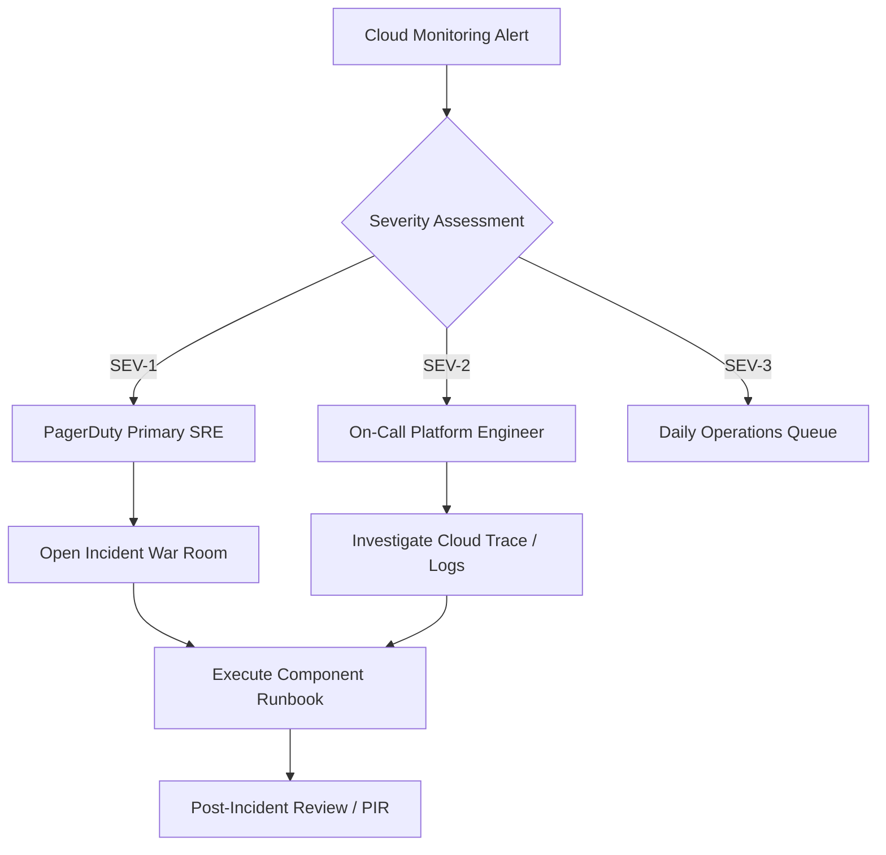

# Operational Runbook: Incident Response Protocol

This runbook defines the severity classifications, escalation pathways, and initial triage procedures for production incidents affecting the Contact Center Agent Helper Platform.

---

## 1. Incident Severity Matrix

| Severity | Definition | Target Response (SLA) | Notification Channel |
|---|---|---|---|
| **SEV-1 (Critical)** | Complete service outage, WebSocket connection failure rate > 5%, or data leakage. | **< 15 minutes** | PagerDuty high-priority page, War Room bridge |
| **SEV-2 (High)** | Assist recommendation p95 latency > 2.5s, or Groundedness score drop < 0.90. | **< 30 minutes** | PagerDuty team page, Slack `#cc-incidents` |
| **SEV-3 (Moderate)** | Non-blocking degradation (e.g., feedback ingestion backlog, single node failure). | **< 2 hours** | Slack `#cc-ops` notification |

---

## 2. Escalation & On-Call Workflow



---

## 3. Immediate Triage Checklist (First 15 Minutes)

1. **Verify WebSocket Health & Drop Rate**:
   * Inspect Cloud Run metrics dashboard: active connections, 5xx error responses.
   * Query BigQuery audit log:
     ```sql
     SELECT COUNT(*) as drops
     FROM `cc_audit_logs_prod.cloudaudit_googleapis_com_data_access`
     WHERE jsonPayload.event_type = 'session.drop'
       AND timestamp > TIMESTAMP_SUB(CURRENT_TIMESTAMP(), INTERVAL 15 MINUTE);
     ```

2. **Check Cloud Trace Latency Decomposition**:
   * Open Cloud Trace console. Filter by `status:error` or `latency > 2.5s`.
   * Identify bottleneck span:
     * `stt.audio_chunk` (> 500ms $\rightarrow$ Speech-to-Text quota/backlog).
     * `intent.classification` (> 100ms $\rightarrow$ Vertex AI GPU bottleneck).
     * `rag.hybrid_search` (> 100ms $\rightarrow$ Cloud SQL connection pool exhaustion).
     * `llm.generate_action` (> 2000ms $\rightarrow$ Gemini API rate limits).

3. **Verify Security Invariants**:
   * Ensure customer isolation filter is active: customer WebSockets must never receive assist events (`issue.update`, `assist.recommendation`).
   * Confirm DLP redaction is functioning on all persisted transcripts.
